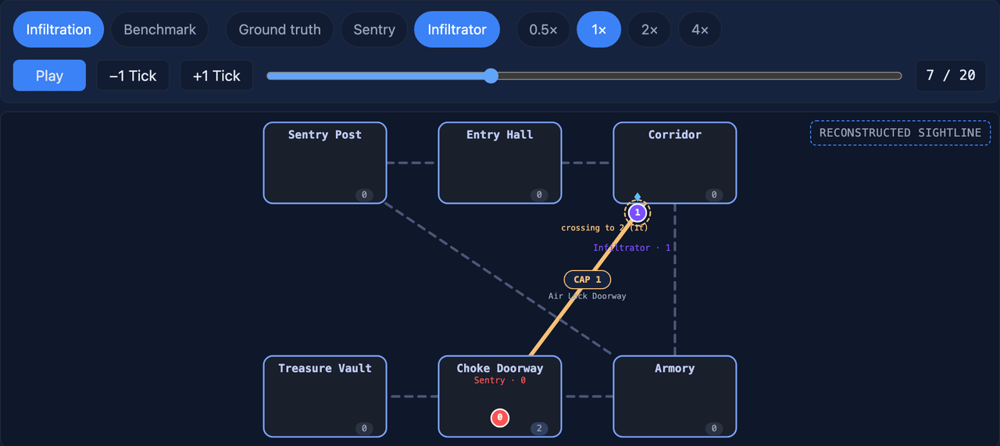

<p align="center">
  
</p>

# Lattice

<p align="center"><strong>A deterministic multi-agent environment for auditable agent benchmarking.</strong></p>

<p align="center">
  <a href="https://github.com/candavere/lattice/actions/workflows/ci.yml"></a>
  
  <a href="https://github.com/candavere/lattice/blob/main/LICENSE"></a>
</p>

<p align="center"><sub>Every production assembly is pure .NET 10 BCL with zero external
NuGet runtime packages. The test project and development tooling do use packages
(<code>Microsoft.NET.Test.Sdk</code>, <code>xunit</code>,
<code>xunit.runner.visualstudio</code>); the zero count is not a claim about the
whole repository. See <a href="docs/ECOSYSTEM.md">docs/ECOSYSTEM.md</a>.</sub></p>

<p align="center">
  
</p>

## What Lattice is

Multi-agent claims live on a spectrum between "we ran it once somewhere" and
"here is the run, the seed, and the reproducible harness". Lattice is built for
the second end. It is a headless .NET 10 environment for deterministic
Dec-POMDP-style experiments under partial observability, dynamic topology, and
resource contention: a run is a pure step contract, each tick a function of the
prior state and the recorded actions, with no hidden state, no singletons, and
no ambient randomness. Every command is seeded, so a run is a stable object you
can inspect, fork from tick K, or hand to a reviewer.

The environment is the product and policies are evaluation subjects. Lattice is
an auditable research and benchmarking environment, not game middleware or a
game-AI product, and MCTS is one evaluation subject here, not the product. A
negative result is first-class evidence, not something to hide: the committed
32-rollout MCTS study **loses** to a deterministic heuristic, that loss is the
baseline any future policy must beat, and it is published with its confidence
interval. See [Results](docs/RESULTS.md) and the artifact behind the headline
below.

The viewer shows only what a recording supports: ground truth, recorded
perception, and derived sightline are labelled separately. [Replay the
infiltration recording in your browser](https://candavere.github.io/lattice/);
the claim and presence semantics, and the pixel and geometry tests that pin
them, are in
[`docs/SUPPORT_AND_REPRODUCIBILITY.md`](docs/SUPPORT_AND_REPRODUCIBILITY.md#viewer-claim-semantics).

## The thesis in one minute

From a clean checkout (see [Get started](#get-started)), every run is seeded,
every run is a recording, and every recording can be replayed and checked:

```sh
dotnet run -c Release --project Cli -- simulate --seed 42 --steps 100 --out run.jsonl
dotnet run -c Release --project Cli -- replay run.jsonl --verify
dotnet run -c Release --project Cli -- evaluate --seed-set dev --scenario standard --seeds 30 --rollouts 32
```

The third command runs a local 30-seed paired study (no network) and prints the
honest case: on the standard study the built-in MCTS baseline loses to a
deterministic heuristic. That committed loss is the baseline, not a failure to
hide. To put your own agent in the loop, see [Bring your own
agent](#bring-your-own-agent).

## Headline result

| Study | Result | Artifact |
| :--- | :--- | :--- |
| Standard generated maps | 32-rollout MCTS **loses** to the deterministic Scout heuristic: mean paired delta **-1.12**, 95% CI **[-1.37, -0.87]** on 50 dev seeds; held-out **-1.25**, **[-1.54, -0.96]** on 50 seeds. This is the committed negative baseline. | [`benchmarks/mcts_evaluation_results.json`](benchmarks/mcts_evaluation_results.json) |
| Capacity-1 bottleneck | The **same policy wins** when both agents are funneled through chokepoints into one shared vault: **+2.03**, CI **[+1.66, +2.41]** on 30 dev seeds; held-out **+2.60**, **[+2.20, +3.00]** on 30 seeds. Topology changed the conclusion. | [`benchmarks/bottleneck_evaluation_results.json`](benchmarks/bottleneck_evaluation_results.json) |

The full tables, the pre-fix comparison, the five-workload throughput record,
and the negative-results list are in [`docs/RESULTS.md`](docs/RESULTS.md). Every
number keeps its dated or scoped label and its committed-artifact link there.

## Get started

Requires the [.NET 10 SDK](https://dotnet.microsoft.com/download). From a clean
checkout:

```sh
git clone https://github.com/candavere/lattice.git
cd lattice
./setup.sh              # macOS/Linux; Windows: .\setup.ps1
```

`setup.sh` verifies the SDK, restores, builds, runs the full test suite, and
reproduces the golden replay. It is idempotent, uses no `sudo`, and installs no
system software. `make setup` is equivalent on macOS/Linux. To run the
quickstart by hand after restore:

```sh
dotnet build Lattice.sln -c Release
dotnet test Lattice.sln -c Release --no-build
dotnet run -c Release --project Cli -- replay Tests/fixtures/golden_trajectory.jsonl --verify
```

Published users: use the **v3.1.0** native binaries from the [GitHub
Release](https://github.com/candavere/lattice/releases/tag/v3.1.0)
(`lattice-linux-x64`, `lattice-osx-arm64`, `lattice-win-x64.exe`, plus
`SHA256SUMS.txt`); there is no registry package. Candidate source is **4.0.0,
unreleased**: pack it locally and install into a throwaway tool path only, never
a global `-g` install. Full install, packaging, launcher, and `DOTNET_ROOT`
details: [`docs/INSTALL.md`](docs/INSTALL.md).

## Bring your own agent

Lattice speaks a normative, language-neutral wire protocol over stdin/stdout, so
any language that speaks protocol 1 can play. The contract is
[`docs/EXTERNAL_AGENT_PROTOCOL.md`](docs/EXTERNAL_AGENT_PROTOCOL.md); the worked
example is [`examples/python/lattice_agent.py`](examples/python/lattice_agent.py),
about 150 lines of standard-library Python.

```sh
dotnet run --project Cli -- evaluate --scenario standard --seed-set dev --seeds 30 \
  --agent-cmd "python3 examples/python/lattice_agent.py"
```

That runs the 30-seed paired study as 60 short-lived Python processes; it needs
Python 3.8+ (standard library only) and a built CLI, and it contacts no network.
The measured result is in
[`examples/python/README.md`](examples/python/README.md): the same agent
**fails** the standard suite (mean -0.383, 95% CI [-0.672, -0.095]) and
**passes** the bottleneck suite (+1.733, [+1.424, +2.042]) on the same 30 dev
seeds. Neither number is a quality claim; the harness is the thing to check.

The v4 candidate adds a model-backed adapter for OpenAI-compatible
chat-completions endpoints. It is a candidate, not a released feature; the
options and the acceptance status are in
[`docs/CLI.md`](docs/CLI.md#model-adapter-lattice_model_agentpy) and
[`docs/V4_CANDIDATE_ACCEPTANCE.md`](docs/V4_CANDIDATE_ACCEPTANCE.md).

## Where to go next

| If you want to... | Go here |
| :--- | :--- |
| Run any command, with every flag | [`docs/CLI.md`](docs/CLI.md) |
| Install, pack, or use the launcher | [`docs/INSTALL.md`](docs/INSTALL.md) |
| Check the claims, gates, and test evidence | [`docs/VERIFICATION.md`](docs/VERIFICATION.md) |
| Read the full results and negative results | [`docs/RESULTS.md`](docs/RESULTS.md) |
| Design an experiment as a scenario file | [`docs/SCENARIOS.md`](docs/SCENARIOS.md) |
| Benchmark, reproduce, or re-gate throughput | [`docs/BENCHMARKING.md`](docs/BENCHMARKING.md) |
| Embed Lattice in a host, or see the architecture | [`docs/ECOSYSTEM.md`](docs/ECOSYSTEM.md) |
| Read the engine mechanics | [`docs/MECHANICS.md`](docs/MECHANICS.md) |
| Understand support, boundaries, and the trajectory schema | [`docs/SUPPORT_AND_REPRODUCIBILITY.md`](docs/SUPPORT_AND_REPRODUCIBILITY.md) |
| Play as an external agent | [`docs/EXTERNAL_AGENT_PROTOCOL.md`](docs/EXTERNAL_AGENT_PROTOCOL.md) · [`examples/python/`](examples/python/README.md) |
| Verify a published release asset-for-asset | [`docs/reproduction_packet.md`](docs/reproduction_packet.md) |
| Read the v4 candidate acceptance evidence | [`docs/V4_CANDIDATE_ACCEPTANCE.md`](docs/V4_CANDIDATE_ACCEPTANCE.md) |
| Audit a claim or a criticism | [`docs/CLAIM_CALIBRATION_MATRIX.md`](docs/CLAIM_CALIBRATION_MATRIX.md) · [`docs/FINDINGS_LEDGER.md`](docs/FINDINGS_LEDGER.md) |
| Read the design decisions (ADRs) | [`docs/adr/`](docs/adr/) |
| Contribute, report a vulnerability, or read the code of conduct | [`CONTRIBUTING.md`](CONTRIBUTING.md) · [`SECURITY.md`](SECURITY.md) · [`CODE_OF_CONDUCT.md`](CODE_OF_CONDUCT.md) |
| See the fuzzing harness and its honest scope | [`docs/FUZZING.md`](docs/FUZZING.md) |
| Watch a committed recording replay | <https://candavere.github.io/lattice/> |

## Trust and boundaries

Lattice is developed through AI-assisted implementation under human direction,
architectural specification, and review. Claims enter the repository only when
they map to committed code, deterministic tests, CI workflows, or benchmark
artifacts; AI assistance is an authoring method, never independent validation.
It is a research preview, not qualified for production or critical-infrastructure
use. Independent replication starts with
[`docs/reproduction_packet.md`](docs/reproduction_packet.md) and
[`docs/VALIDATION_PLAN.md`](docs/VALIDATION_PLAN.md); governance is in
[`docs/FINDINGS_LEDGER.md`](docs/FINDINGS_LEDGER.md) and
[`docs/CLAIM_CALIBRATION_MATRIX.md`](docs/CLAIM_CALIBRATION_MATRIX.md).

## Known limitations

- **Research preview.** Not qualified for production or critical-infrastructure
  use. The supported matrix and operational boundaries are in
  [`docs/SUPPORT_AND_REPRODUCIBILITY.md`](docs/SUPPORT_AND_REPRODUCIBILITY.md).
- **Replay verifies the recorded environment actions.** It cannot reproduce a
  nondeterministic external agent's decisions; such an agent yields a different
  trajectory from the same seed on every run, and `replay --verify` still
  succeeds on each one.
- **The hosted arm64 `runner-class-gate` enforces 4 of 5 workloads.**
  `policy_lookahead_mcts_32` is a permanent non-verdict by design
  ([`FINDING-014`](docs/FINDINGS_LEDGER.md#finding-014--the-mcts-decision-throughput-case-cannot-be-gated-on-this-host-class-and-four-of-five-workloads-can));
  a green Benchmarks workflow is a narrow claim on that runner class.
- **A seed with one completed match and one void refuses the study.** Dropping
  the one-sided seed and reporting the drop is planned for v3.2; the constraint
  is in [`docs/SUPPORT_AND_REPRODUCIBILITY.md` §3](docs/SUPPORT_AND_REPRODUCIBILITY.md#3-known-limitations).
- **A small number of tests flake under the full parallel run.** A green run is
  evidence, not a guarantee; the current per-OS counts are the CI artifacts, and
  the known flake history is in
  [`docs/VERIFICATION.md`](docs/VERIFICATION.md#flaky-tests-are-known-and-listed).
- **At a 390px viewport the viewer's room titles render at roughly 8.3px.**
  Every title is complete and inside its room, but small; wider viewports render
  at 11px.

The full list, including timing bounds and the `TempFile` test-helper caveat, is
in [`docs/SUPPORT_AND_REPRODUCIBILITY.md` §3](docs/SUPPORT_AND_REPRODUCIBILITY.md#3-known-limitations).

## Citation

If you use Lattice in research, please cite it. The machine-readable record is
[`CITATION.cff`](CITATION.cff).

```bibtex
@misc{YourReferenceHere,
  author = {Mehta, Deep},
  title = {Lattice},
  year = {2026},
  url = {https://github.com/candavere/lattice}
}
```

## License

MIT — see [`LICENSE`](LICENSE).
